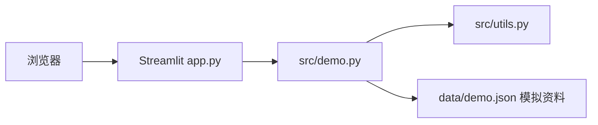

# 当前技术栈（2026-10-20 修订）

网页为 Streamlit；计算在同一 Python 进程中的 `src/utils.py` 完成，`src/demo.py` 提供最小页面和数据校验。无需独立 HTTP API、Node 或数据库。

数据来自 `data/demo.json`，均为人工模拟。旧版实验目录为 `team/archive/experimental.json`，模拟趋势在 `team/archive/derived_latest_q2_2025.json`。没有抓取任务、SQLite/Postgres 连接、模型训练或网页到 RunPod 的调用。

`app.py` 是唯一网页入口；`src/main.py` 是复用同一最小数据与逻辑的 CLI 检查工具。依赖安装在 `.venv`；根 `requirements.txt` 记录运行依赖；开发检查依赖单独记录。`runpod/requirements.txt` 仅用于未接入的历史实验。

Replit 仅提供待验证配置。原架构 PNG 是历史规划，不能作为现状或平台使用证据。
